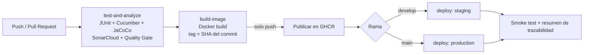

# Postulaciones — Microservicio de postulaciones (TalentoYa)

Microservicio del **caso 02 — TalentoYa** (app de búsqueda de empleo). En la Evaluación Parcial N°2 de **DOY0101 — Ingeniería DevOps** se automatiza todo su ciclo de vida con un pipeline CI/CD en GitHub Actions.

| | |
|---|---|
| Stack | Spring Boot 3.3 · Java 21 · Maven · Spring Data JPA · H2 · springdoc-openapi |
| Calidad | JUnit 5 + Mockito · Cucumber (BDD) · JaCoCo (100% de líneas) · SonarCloud |
| Contenedores | Docker (multi-stage, usuario no root) · Docker Compose · manifiestos Kubernetes |
| CI/CD | GitHub Actions · GitHub Container Registry (GHCR) · Dependabot |

## Responsabilidad (SRP)

Administra los datos y la lógica del dominio de Postulaciones. Su base de datos es una **H2 en memoria** (un microservicio por base).

## Endpoints

| Método | Ruta | Descripción |
|--------|------|-------------|
| GET | `/api/postulaciones` | Lista todos los recursos |
| GET | `/api/postulaciones/{id}` | Obtiene un recurso por id |
| POST | `/api/postulaciones` | Crea un recurso |
| PUT | `/api/postulaciones/{id}` | Actualiza un recurso |
| DELETE | `/api/postulaciones/{id}` | Elimina un recurso |

Documentación: Swagger UI `/swagger-ui/index.html`, OpenAPI `/v3/api-docs.yaml`, ReDoc `/redoc.html`.

---

## Pipeline CI/CD

El workflow está en [`.github/workflows/ci-cd.yml`](.github/workflows/ci-cd.yml) y se ejecuta en cada `push` a `develop` y `main`, y en cada Pull Request.



| Job | Qué hace | Falla si... |
|-----|----------|-------------|
| `test-and-analyze` | Ejecuta pruebas unitarias y BDD, mide cobertura con JaCoCo y analiza con SonarCloud | Falla una prueba, la cobertura de líneas baja de 100%, o **el Quality Gate de SonarCloud no pasa** |
| `build-image` | Construye la imagen con el `Dockerfile` y la publica en GHCR (solo en `push`) | El build de Docker falla |
| `deploy` | Descarga la imagen del commit, la levanta con Docker Compose en un entorno simulado y hace un smoke test | El contenedor no queda saludable o la app no responde |

Los jobs están encadenados con `needs:`, por lo que **no se construye ni despliega nada si fallan las pruebas o el análisis**.

### Seguridad

- **Dependabot** (`.github/dependabot.yml`) revisa semanalmente dependencias Maven, imágenes Docker y Actions.
- **SonarCloud** analiza el código; con `sonar.qualitygate.wait=true` el pipeline se bloquea si el Quality Gate falla.
- La rama `main` debe tener **branch protection** que exija que el check del CI pase antes de hacer merge.
- Permisos mínimos del workflow (`contents: read`; `packages: write` solo en el job que publica la imagen).
- Contenedor con usuario no root, sistema de archivos de solo lectura, `cap_drop: ALL` y `no-new-privileges`.
- En los entornos desplegados la consola H2 y el log de SQL están desactivados (`H2_CONSOLE_ENABLED=false`, `SHOW_SQL=false`).

### Escalabilidad

- Compose: límites y reservas de CPU/memoria, `healthcheck` y `JAVA_OPTS` con `MaxRAMPercentage`.
- Kubernetes (`k8s/`): 2 réplicas, `RollingUpdate`, probes de readiness/liveness, requests/limits y `HorizontalPodAutoscaler` (2 a 5 pods, 70% CPU).

### Trazabilidad

Cada despliegue se puede rastrear de punta a punta:

1. Commit → ejecución del workflow en la pestaña *Actions*.
2. La imagen se publica como `ghcr.io/<owner>/postulaciones-svc:<SHA del commit>` y lleva las etiquetas OCI `revision` y `source`.
3. El job `deploy` despliega **exactamente esa imagen** y escribe en el resumen de la ejecución el entorno, el commit, la imagen y quién lo ejecutó.
4. Los reportes de pruebas y cobertura quedan como artefactos de cada ejecución.
5. `develop` se despliega en el entorno `staging` y `main` en `production` (GitHub Environments).

### Calidad

Cobertura mínima de 100% de líneas (JaCoCo, falla en `mvn verify`), pruebas BDD con Cucumber sobre los endpoints reales, Quality Gate de SonarCloud y revisión obligatoria de Pull Requests por el otro integrante.

---

## Cómo ejecutar

```bash
mvn spring-boot:run                 # local
mvn verify                          # pruebas + cobertura (falla si baja de 100%)
docker compose up --build           # Docker Compose (http://localhost:8080)
H2_CONSOLE_ENABLED=true docker compose up --build   # con consola H2 (solo desarrollo)
```

### Kubernetes (opcional)

```bash
# editar la imagen en k8s/deployment.yaml (<owner> y <sha>)
kubectl apply -f k8s/
```

## Configuración necesaria en GitHub

- Secret `SONAR_TOKEN` en *Settings → Secrets and variables → Actions* **y también en la pestaña Dependabot** (para que los PR de Dependabot pasen el CI).
- Branch protection en `main` (y `develop`) exigiendo el check `Pruebas y SonarCloud`.
- Entornos `staging` y `production` (se crean solos en el primer despliegue; en `production` se pueden exigir revisores).
- Activar *Dependabot alerts* y *security updates*.

## Documentación del proyecto

- [`docs/00_Resumen.md`](docs/00_Resumen.md) · [`docs/01_Arquitectura.md`](docs/01_Arquitectura.md) · [`docs/02_API.md`](docs/02_API.md) · [`docs/03_Pruebas.md`](docs/03_Pruebas.md) · [`docs/04_Despliegue.md`](docs/04_Despliegue.md) · [`docs/05_Justificacion.md`](docs/05_Justificacion.md) · [`docs/diagramas/`](docs/diagramas/)

## Modelo de ramificación y buenas prácticas

GitFlow: `main` guarda las versiones estables y `develop` integra los cambios del equipo. Ramas `feature/<descripcion>` hacia `develop` y `hotfix/<descripcion>` hacia `main`, siempre por Pull Request revisado por el otro integrante. Commits con formato `tipo(alcance): descripcion-corta` (`feat`, `fix`, `docs`, `chore`).

---

## Declaración de uso de IA

> **COMPLETAR POR EL EQUIPO** (la evaluación exige declarar y citar el uso de IA: https://bibliotecas.duoc.cl/ia).
> Indicar qué herramienta se usó, para qué (por ejemplo: apoyo en la redacción de archivos de configuración del pipeline, Dockerfile, Compose y manifiestos) y cómo se validó el resultado.

## Conclusiones y reflexiones individuales

> **ESCRIBIR SIN APOYO DE IA** (requisito de la evaluación).

### Integrante 1
_(reflexión personal: aprendizaje y contribución al proyecto)_

### Integrante 2
_(reflexión personal: aprendizaje y contribución al proyecto)_
